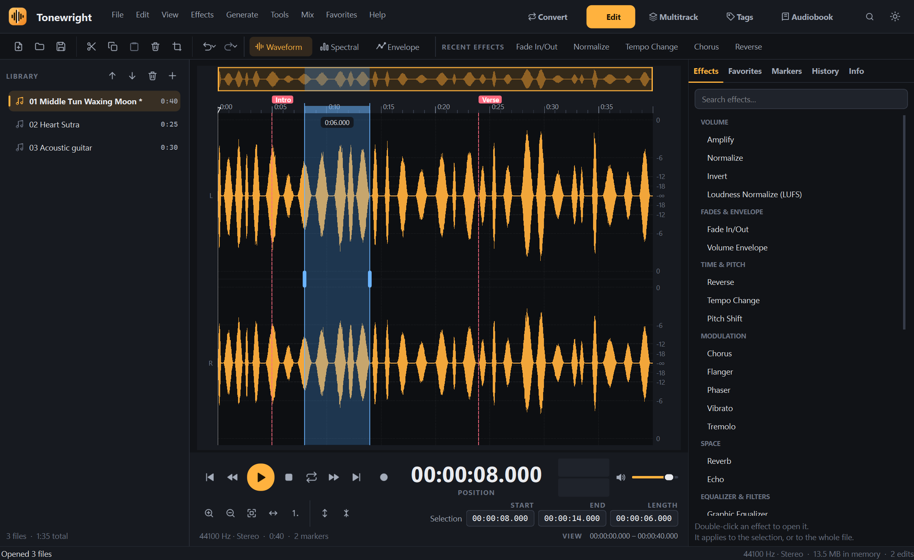
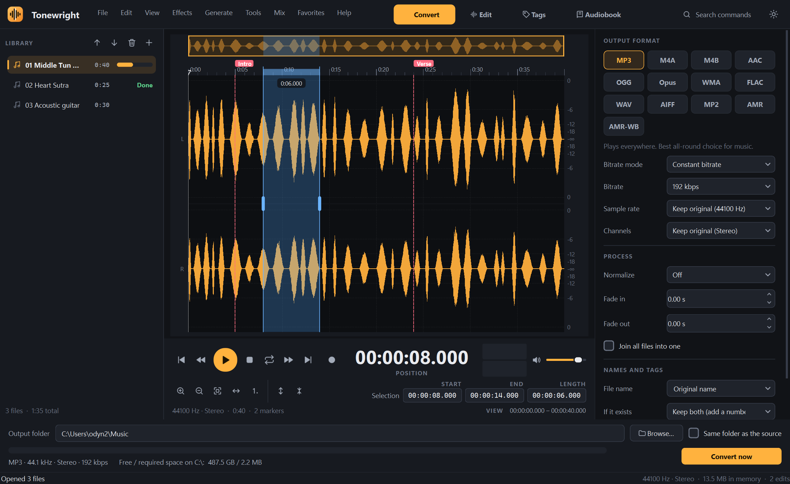
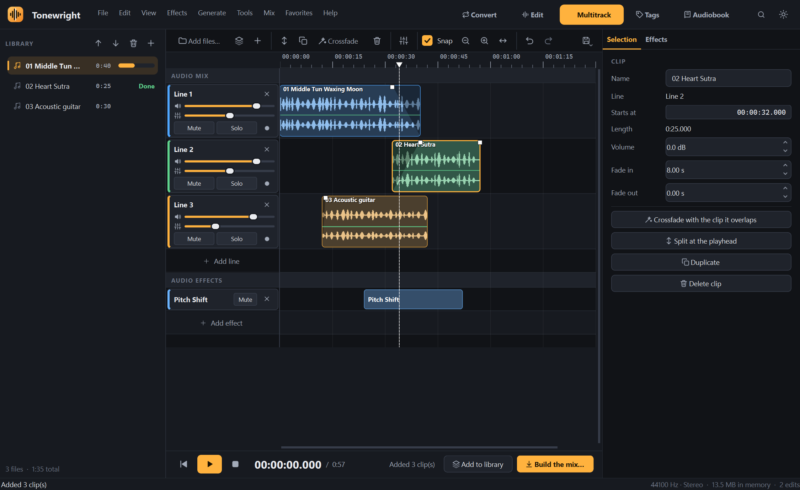
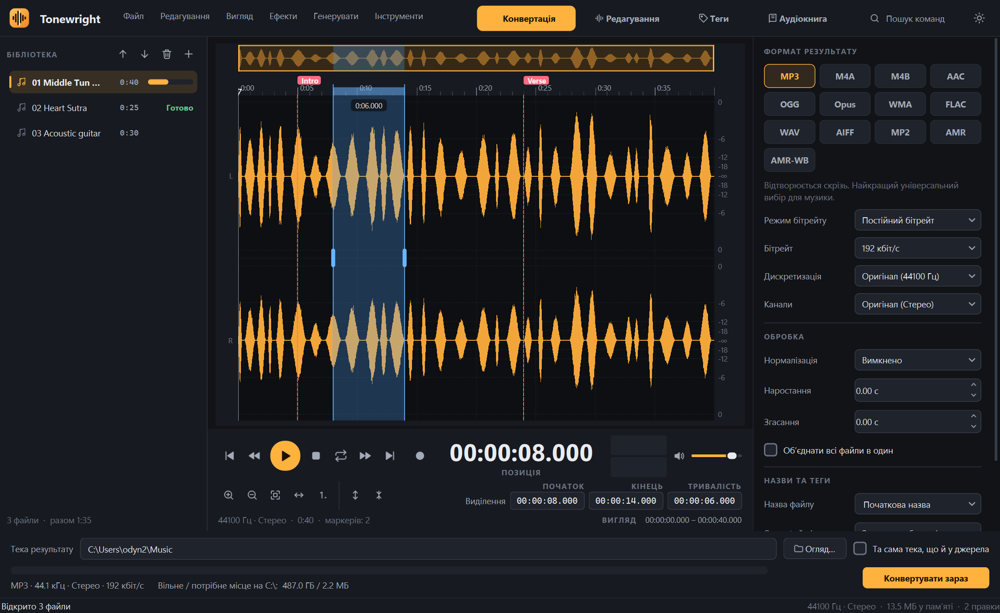

# Tonewright

A personal audio converter and editor for Windows and for Macs with Apple Silicon (M1 and newer). It does the same jobs
as the two programs in the photos (a waveform editor with effects, a batch converter with a tag editor, and an
audiobook maker), in one window, with its own look and its own way of working.



## Install it

Run **`Tonewright-Setup-1.0.0.exe`** (build it with `installer\build_installer.ps1`, see below). It installs into
`C:\Program Files\Tonewright` (Windows asks for administrator approval once), so only an administrator can change the
program files. Your settings, favourites and log stay in `%APPDATA%\Tonewright`, because Program Files is read-only for
normal use. It adds a Start-menu entry and an optional Desktop icon, and has its own uninstaller. If you installed an
earlier per-user copy, remove it in Settings > Apps after this one is in. Python, the libraries and FFmpeg are all
inside it, so nothing else has to be installed; the wizard is available in English and Ukrainian. Installing a newer
version over an older one just upgrades it and keeps your settings.

### On a Mac (M1 and newer)

The app is built by GitHub: open the repository's **Actions** tab, pick the latest **macOS** run and download the
**tonewright-macos-arm64** artifact. It holds `Tonewright-1.0.0-arm64.dmg` and `SHA256SUMS.txt` (check the file against
it with `shasum -a 256`). Open the `.dmg` and drag **Tonewright** onto **Applications**. FFmpeg is inside the app.

* **Opening it the first time.** The app is signed ad hoc, which is what Apple Silicon needs to run it at all, but it is
  not notarised by Apple (that needs a paid developer account), so macOS says it "could not verify Tonewright is free of
  malware" and will not open it. This is Gatekeeper reacting to the download, not to FFmpeg or anything inside the app.
  Remove the download flag once, in Terminal, then open the app as usual:

  ```
  xattr -dr com.apple.quarantine /Applications/Tonewright.app
  open /Applications/Tonewright.app
  ```

  Or, without Terminal: try to open it, then go to **System Settings > Privacy & Security**, scroll down and press
  **Open Anyway**. (On recent macOS versions Control-click > Open no longer gets past this.) Do the same again after
  installing a newer version. Installing it with a Homebrew cask does not avoid this: Homebrew puts the same download
  flag on the app, so the `xattr` command is still needed.
* **Settings** live in `~/Library/Application Support/Tonewright`.
* **Shortcuts:** wherever this guide says `Ctrl`, use **⌘ Command** on a Mac.
* **Microphone:** Record asks for permission the first time.
* **Speech** (Generate) uses the voices installed in *System Settings > Accessibility > Spoken Content*.
* **Differences:** the bundled FFmpeg has no Rubber Band or AMR support, so Tempo and Pitch use FFmpeg's own filters (a
  little lower quality on extreme settings) and the AMR formats are not offered.
* **Build it yourself** on an Apple Silicon Mac with `macos/build_app.sh` (needs Python 3.13, `pip install -r
  requirements.lock.txt pyinstaller`). The Mac version was written without access to a Mac; the GitHub run runs the whole
  test suite and a start-up test of the finished app on a real one.

## Start it from the source folder instead

On a Mac, run **`Tonewright.command`** (needs Python 3 and `brew install ffmpeg`). On Windows, double-click **`Tonewright.bat`**. The first time it creates a private Python environment in
this folder and installs what it needs (about a minute, needs internet once). After that it
opens straight away.

* **FFmpeg** must be installed (`winget install Gyan.FFmpeg` on Windows, `brew install ffmpeg` on a Mac).
* Want a Desktop / Start-menu icon? Run `powershell -ExecutionPolicy Bypass -File create_shortcut.ps1`.
* You can also drag audio files onto `Tonewright.bat`, or run `python -m tonewright file1.mp3 file2.wav`.

Everything runs offline on your PC. Your files are never changed unless you press Save, and even
then you are asked first.

## The five modes

Switch with the tabs at the top (or `Ctrl+1` … `Ctrl+5`). They all share one **Library** list on
the left, so a file you edited in *Edit* is the version that gets converted in *Convert*
(edited files show a `*`).

| Mode | What it is for |
| --- | --- |
| **Convert** | Batch conversion to MP3, M4A, M4B, AAC, OGG, Opus, WMA, FLAC, WAV, AIFF, MP2 and AMR. Choose the bitrate or quality, sample rate and channels, optionally normalize, fade the ends, or join everything into one file. Convert, Pause or Stop. The waveform of the selected file is shown above the player. |
| **Edit** | A full waveform editor: select, cut, copy, paste, delete, trim, mix-paste, markers, unlimited undo/redo, three views (Waveform, Spectral, Envelope), 33 effects, generators, recording and analysis tools. |
| **Multitrack** | Lay several files on top of one another on separate lines, set each line's volume and panning, fade and crossfade the clips, add effects over a range, then build the whole mix into one file. See [Multitrack mixing](#multitrack-mixing). |
| **Tags** | Title, artist, album, year, track/disc, genre, composer, comment and **cover art** for one file or many at once. Number tracks, and rename files from their tags with a live preview. |
| **Audiobook** | Binds the library into one `.m4b` with **chapters**, tags and a cover. Chapters can be one per file, N equal parts, every X minutes (optionally snapping to pauses), or taken from markers you set in the editor. Preview and rename the chapters before creating the book. |



### Where things from the old programs went

| You were used to | Here |
| --- | --- |
| New / Open / Save, **Import from Video** | File menu and toolbar. Video files open like any audio file (you choose the audio track if there are several). |
| Copy, Paste, Cut, Delete, **Trim to Selection**, Undo ▾, Redo ▾ | Toolbar and Edit menu. The undo/redo arrows list the steps; the **History** tab jumps anywhere. |
| Waveform / Spectral / Envelope | Toolbar. In *Envelope* click the line to add points, drag them, right-click to remove, then **Apply envelope**. |
| Recent Effects (Tempo, Fade In/Out, Chorus, Phaser, Normalize, Reverse) | The "Recent effects" strip in the toolbar. |
| Effect dialogs with Description, curve, **Preview**, **Bypass**, **To Favorites**, Cancel, OK | Same idea, every effect: description, live curve where it helps, presets, Preview with Bypass for A/B, *To Favorites*. |
| Files / Effects / Favorites panel | Library on the left; **Effects**, **Favorites**, Markers, History and Info tabs on the right. |
| "Processing… Operation in progress…" with Cancel | A progress card with Cancel for anything that takes more than a moment. |
| Record, Generate, Tools, Mix | The **File → Record**, **Generate**, **Tools** and **Mix** menus. |
| Converter's player, file order arrows, Output Folder / Browse / **Convert Now** / Progress / free space | Same controls: transport under the waveform, ▲▼ in the Library, and the bar at the bottom of Convert mode with free vs. required disk space. |
| Name/Tag Editor, **Audiobooks** (No split, Split by files, Split into N chapters, Split by time, Pause detection, Split by markers) | Tags and Audiobook modes, with all of those options. |

**Not included:** *Grab from CD* (needs an optical drive and a ripping library) and DX/VST plug-in
hosting. The closest equivalent is **Effects → Advanced → Custom FFmpeg Filter**, which accepts any
FFmpeg audio filter chain (for example `lowpass=f=3000,volume=2`).

## What you can do in the editor

* **Selection:** drag in the waveform; drag the edges to adjust; double-click selects all; type exact
  times in the Start / End / Length boxes; optional snapping to zero crossings (no clicks at cuts).
* **Zoom:** mouse wheel (towards the pointer), `Shift`+wheel scrolls, `Ctrl`+wheel zooms vertically,
  middle-drag pans. The strip at the top is an overview you can drag. Zoom all the way to single samples.
* **Edits never copy audio**, so cut, paste and undo are instant even on a three-hour file.
* **Effects** (all work on the selection, or the whole file if nothing is selected; most can target
  just the left or right channel):
  * Volume: Amplify, Normalize (peak or RMS), Loudness Normalize (LUFS), Invert
  * Fades & envelope: Fade In/Out (5 curve shapes), Volume Envelope
  * Time & pitch: Tempo Change, Pitch Shift, Reverse
  * Modulation: Chorus, Flanger, Phaser, Vibrato, Tremolo
  * Space: Reverb, Echo
  * Equalizer & filters: 10-band Graphic EQ, 4-band Parametric EQ, Low/High/Band filters, Bass & Treble
  * Dynamics: Compressor, Limiter, Noise Gate
  * Restoration: Noise Reduction (learns a noise sample), Quick Denoise, Click & Clip Repair, Hum Removal, Remove DC Offset
  * Channels: Balance, Channel Mixer, Vocal Remover
* **Generate:** silence, tones and sweeps (sine/square/triangle/saw), white/pink/brown noise, dial tones,
  and speech from the voices installed in Windows.
* **Tools:** audio statistics (peak, RMS, clipping, DC offset, LUFS), frequency analysis, **Find silence**
  (mark it, remove it, or trim the ends), convert a file's sample rate / channel layout.
* **Mix:** mix-paste with level control, mix in another file, insert a file at the cursor.
* **Markers:** press `M`. They show on the ruler, can be renamed and typed in, and drive audiobook chapters.
* **Command palette:** `Ctrl+K` finds any command or effect by name.
* **Light and dark themes** (the sun button).

## Multitrack mixing



Use it for transitions between songs, voice over music, or layering sounds.

* **Add files** with the toolbar button, by dragging from Explorer or from the Library, or with *Add to the
  multitrack mix* in the Library's right-click menu. Each file lands on its own **line**, at the playhead. Lines are mixed together,
  so clips on different lines play at the same time.
* **Move** a clip by dragging it (also between lines). Edges snap to other clips and to the playhead
  (switch **Snap** off to place freely). **Trim** with the clip's left and right edges.
* **Fade** with the small handles at the top corners. A fade is an equal-power curve, so a **Crossfade**
  between two overlapping clips keeps the loudness steady. Select a clip and press *Crossfade*.
* **Volume and pan:** each line has a volume slider and a balance slider (double-click resets), plus
  **Mute** and **Solo**. Drag the green line inside a clip to set that clip's own gain.
* **Effects:** *Add effect* puts an effect span under the lines. It affects the whole mix between its
  edges, so drag the ends to choose the range. Effects that change the length of the sound are not allowed
  here.
* **Split** at the playhead, **Duplicate**, **Delete**, and unlimited **Undo / Redo** (`Ctrl+Z` /
  `Ctrl+Y`). Clips never copy audio, so these are instant.
* **Play** renders the mix and plays it (`Space`). If the mix would clip, you are offered to lower it.
* **Build the mix…** creates the final file. You can keep it as a document in the Library (to edit it
  further or convert it), or save it straight away in any supported format.
* **Projects:** save the arrangement as a small `.twmix` file and open it later. It stores where the
  source files are, not the audio, so keep the originals in place. A project that contains a **custom
  FFmpeg filter** asks before it runs, because a filter can read files and network addresses.

## Languages

Tonewright speaks **English** and **Ukrainian (українська)**. By default it follows the Windows display
language; change it any time under **View → Language** (it applies the next time you start the app).
The installer's own screens are translated too.



Adding another language means one new file in `tonewright/locales/` (see `tonewright/i18n.py` for the format);
`tests/test_i18n.py` fails if any string the app shows has no translation or if English leaks into the interface.

## Keyboard shortcuts

| | | | |
| --- | --- | --- | --- |
| Open `Ctrl+O` | Save `Ctrl+S` | Save as `Ctrl+Shift+S` | Close file `Ctrl+W` |
| Undo `Ctrl+Z` | Redo `Ctrl+Y` | Cut / Copy / Paste `Ctrl+X/C/V` | Delete `Del` |
| Trim `Ctrl+T` | Silence `Ctrl+L` | Select all `Ctrl+A` | Go to time `Ctrl+G` |
| Play / Pause `Space` | Stop `Esc` | Loop `L` | Record `Ctrl+R` |
| Start / End `Home` / `End` | ±5 s `Ctrl+←` / `Ctrl+→` | Marker `M` | Prev / Next marker `[` `]` |
| Zoom in / out `Ctrl+=` / `Ctrl+-` | Fit `Ctrl+0` | Zoom to selection `Ctrl+9` | Repeat last effect `Ctrl+Shift+E` |
| Search commands `Ctrl+K` | Find an effect `Ctrl+E` | Statistics `Ctrl+I` | All shortcuts `F1` |

## Good to know

* **Saving** writes the same format as the file you opened (with a similar bitrate). Lossy formats lose a
  little quality each time they are re-encoded, so **Save as…** (which never defaults to the original) is
  the safe choice for MP3/M4A/OGG; for lossless (WAV/FLAC) there is no loss.
* **Converting a file next to itself** (e.g. WAV → WAV in the same folder) adds "(converted)" to the name.
  Tonewright never overwrites a source file by accident.
* **Pause** in Convert really pauses FFmpeg; **Stop** removes any half-written file.
* Tags are written with ID3v2.3 (MP3), Vorbis comments (FLAC/OGG/Opus), MP4 atoms (M4A/M4B) and ASF (WMA),
  with Unicode and cover art. AAC (ADTS), AMR and MP2 cannot hold tags; they are skipped, not corrupted.
* Settings, favourites and a log live in `%APPDATA%\Tonewright\`. If something ever goes wrong you will see a
  message, and the details are saved to `tonewright.log` there.

## Troubleshooting

* **"Tonewright needs FFmpeg"**: run `winget install Gyan.FFmpeg`, then start again. (Or set `ffmpeg_dir` in
  `%APPDATA%\Tonewright\settings.json`.)
* **The first start fails while installing:** you need Python 3.10 or newer (`winget install Python.Python.3.13`)
  and an internet connection. Delete the `.venv` folder and double-click `Tonewright.bat` to start the setup again.
* **Importing numpy fails after a Python upgrade:** packages installed for an older Python in the global
  environment can stop loading (this happened with Python 3.14 → 3.15). Tonewright is not affected because it
  uses its own `.venv`, which is built for whichever Python created it.

## For developers

```
tonewright/
  core/        no Qt: FFmpeg wrapper, piece-table Document (undo, markers, peaks), effects, formats,
               tags, conversion, audiobook builder, analysis, generators
  audio/       playback and recording through PortAudio (sounddevice)
  ui/          PySide6 widgets: stage (waveform), transport, library, dialogs, panels, main window
  tests/       pytest: core, audio (with a fake sound card) and 50+ end-to-end GUI tests
  tools/       make_icon.py, screenshots.py
```

```
.venv\Scripts\python.exe -m pip install -r requirements-dev.txt
.venv\Scripts\python.exe -m pytest
```

Build the installer (needs the `.venv`, FFmpeg and Inno Setup 6, see the header of the script):

```
powershell -ExecutionPolicy Bypass -File installer\build_installer.ps1
```

It stages a private Python (checked against a pinned SHA-256), the libraries pinned in `requirements.lock.txt`, the
program and FFmpeg; smoke-tests that staged copy with its own Python (no window is shown); and only then compiles
`installer\dist\Tonewright-Setup-<version>.exe` plus a `.sha256` file.

The GUI tests never show a window and script every dialog, so they are safe to run while you work.
`python -m tonewright --selftest out.png` starts the real app, saves a screenshot and exits.
